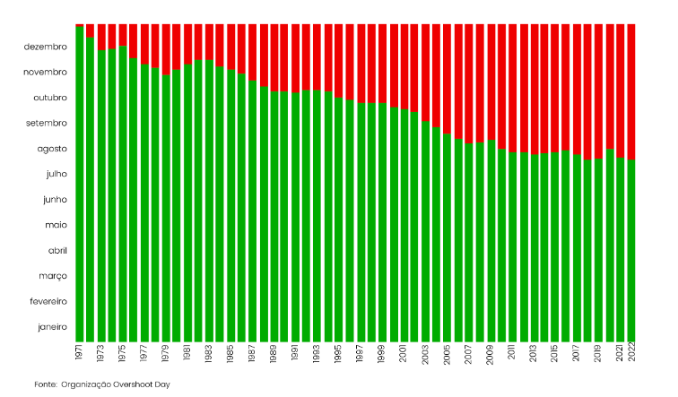

A **Pegada Ecológica** mede o uso de terra cultivada, florestas, pastagens e áreas de pesca para o fornecimento de recursos e absorção de resíduos (dióxido de carbono proveniente da queima de combustíveis fósseis).

Ao longo de cada ano, a humanidade vai consumindo recursos naturais do planeta e o desejável seria que o planeta os conseguisse regenerar. Mas não é bem assim e a pegada ecológica aumenta. Tem-se verificado que a certa altura do ano o planeta deixa de ter capacidade para o fazer. Esse dia é chamado o **Dia da Sobrecarga** ou *Overshoot Day*. E a humanidade passa a viver a crédito (como se fizesse um empréstimo).

- Em 1971, o Dia da Sobrecarga ocorreu no final do ano.
- A partir daí, foi cada vez mais cedo. Em 1977 já ocorreu em novembro.
- Nos últimos 13 anos tem acontecido entre os finais de julho e o início de agosto. No ano passado, 2023, foi a 2 de agosto.
- Nos últimos cinco anos, a situação não se tem agravado, talvez devido “aos esforços de descarbonização e a um conjunto de políticas implementadas que visam promover o respeito pelos limites do planeta”.
- No dia **3 de maio de 2024**, a **UE esgotou todos os recursos de 2024**. Se todo o mundo vivesse como os europeus, a Terra já não tinha mais recursos para serem gastos este ano!
- **Era preciso três planetas só para o consumo da UE.**

## O que podemos fazer?

| Medida | Efeito |
| --- | --- |
| Reduzir o desperdício alimentar para metade | Por si só, permite atrasar cerca de 13 dias o recurso ao crédito. |
| Reduzir a pegada ligada à mobilidade em 50 % | Pode atrasar o recurso ao cartão de crédito ambiental, aproximadamente, 13 dias com a utilização de transportes públicos, bicicleta ou andando a pé. |
| Uma maior aposta em fontes de energia renováveis, como a solar ou a eólica | Poderia alimentar 75 % das necessidades mundiais de eletricidade, o que permitiria atrasar em 26 dias o uso do cartão de crédito ambiental do planeta. |
| Redução do consumo de carne em 50 % | Por si só, permitiria atrasar em 13 dias o recurso ao crédito. |

O impacto mais significativo seria resultado de uma redução da pegada de carbono em 50 %. Os cálculos da Zero sugerem que, desta forma, seria possível atrasar o crédito ambiental em 93 dias, ou seja, este dia teria lugar apenas em novembro.

Dá que pensar… Mas precisamos de pensar e de agir!

*Fonte: [eco.sapo.pt](https://eco.sapo.pt/2023/08/02/dia-da-sobrecarga-planeta-esgotou-recursos-e-vive-de-credito-ambiental-a-partir-de-hoje/)*
