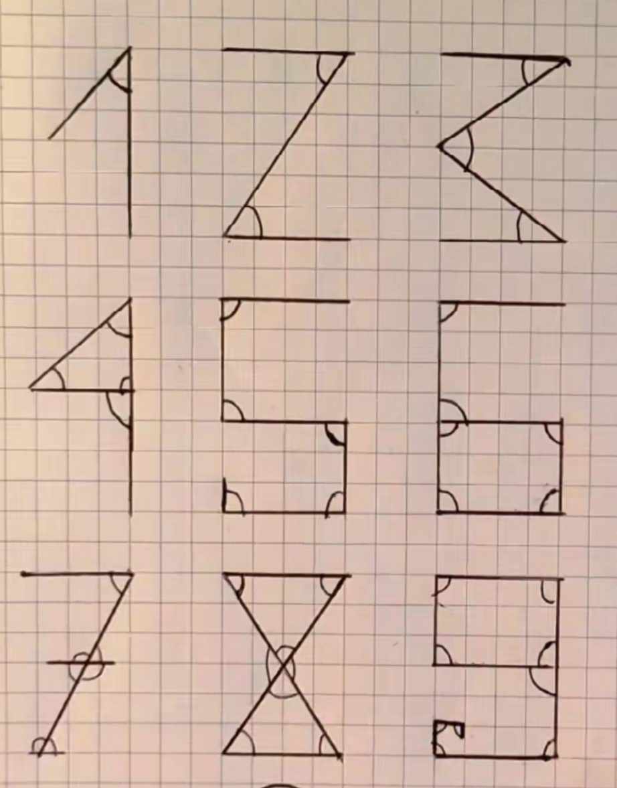

## Googol / Googolplex

Uma curiosidade fascinante da Matemática é sobre os números Googol e Googolplex.

Um *googol* é um termo matemático para definir um número gigantesco: <u>1 seguido de cem zeros</u> ($10^{100}$).

O *googolplex* é outro número muito, mas muito maior: o número 1 seguido de um googol de zeros, $10^{10^{100}}$…

**Não há espaço suficiente no planeta para escrever um Googolplex!** Este nome inspirou os fundadores do Google.

## Primos

<Desafio titulo="Primos que terminam em 2, 5 ou 0">

Os únicos números primos que terminam em 2 e 5 são 2 e 5. Nenhum número primo termina em 0. Porquê?

Um número que termina em 2 (ou em 0) é par, logo divisível por 2; um número que termina em 5 (ou em 0) é divisível por 5. Só o próprio 2 e o próprio 5 escapam, porque são primos. Nenhum número terminado em 0 é primo, porque é divisível por 2 e por 5 (e não é nenhum deles).

</Desafio>

## Brincando com palavras 1

Lewis Carroll, **matemático** e autor de *Alice no País das Maravilhas*, entre outras obras, inventou um jogo chamado *Doublets*. O objetivo desta brincadeira é partir de uma palavra e chegar a outra, trocando uma letra de cada vez, desde que a mudança dê origem a uma palavra da língua portuguesa (ou da língua na qual se está a jogar, como é óbvio).

Por exemplo, um Doublet que parta de “vida” e chegue a “bela” pode ser feito assim: vida → vila → vela → bela.

**Experimenta fazer os seguintes Doublets:** sou → lei; tem → voz; fim → sós; tem → cor; cabe → tudo; seis → sete; sete → vela; bom → mau.

## Brincando com palavras 2

> Sguedno um etsduo da Uinvesriadde de Cmabgirde, a oderm das lertas nas pavralas não tem qsuae nhneuma ipmortância. O que ipmrtoa é que a prmiiera e a útlima lreta etsajem no lcoal cetro. De rseto, pdoe ler tduo sem gardnes dfiilcuddaes… Itso é prouqe o crebéro lê as pavralas cmoo um tdoo e não lreta por lerta.

A partir da palavra “LETRAS”, por exemplo, mantendo o L e o S, podemos formar outras 16 “palavras” diferentes. Algumas destas sem significado na língua portuguesa. No texto (1.ª linha) aparece a “palavra” “LERTAS”.

Ainda conseguimos ler os textos se trocarmos algumas letras por números…

> 35T3 P3QU3N0 T3XT0 53RV3 4P3N45 P4R4 M05TR4R C0M0 N0554 C4B3Ç4 C0N53GU3 F4Z3R C01545 1MPR35510N4ANT35 !! R3P4R3 N1550 !! N0 COM3ÇO 35T4V4 M310 COMPL1C4DO, M45 N3ST4 L1NH4 SU4 M3NT3 V41 D3C1FRANDO O COD1GO QU453 4UTOM4T1C4M3NT3, S3M PR3C1S4R P3N54R MU1TO, C3RTO?

## Frações singulares

Na Matemática encontramos números naturais, inteiros, racionais, fracionários, irracionais, transcendentes, complexos, imaginários, interessantes, amigos, mágicos, produtos curiosos, bailados numéricos, … A palavra fração vem do latim *fractus*, que significa partido. Temos frações próprias, impróprias, aparentes, mistas, unitárias, …

Os números representados por frações podem ser inteiros, dízimas finitas ou dízimas infinitas periódicas. Uma fração que representa um número inteiro diz-se uma fração **aparente**. Por exemplo, $6/3$ (nota que $6/3 = 2$). Outras designações:

- fração **própria** — o numerador é menor do que o denominador;
- fração **imprópria** — o numerador é maior do que o denominador.

Nesta edição apresentamos-te algumas frações <u>singulares</u>: são iguais a um número inteiro e **escrevem-se com os nove algarismos, de 1 a 9, sem repetições**.

$$
\frac{13\,458}{6729} = 2 \qquad \frac{17\,469}{5823} = 3 \qquad \frac{15\,768}{3942} = 4 \qquad \frac{14\,835}{2967} = 5
$$

$$
\frac{34\,182}{5697} = 6 \qquad \frac{16\,758}{2394} = 7 \qquad \frac{25\,496}{3187} = 8
$$

Se utilizarmos os dez algarismos, de 0 a 9, sem repetições, ainda conseguimos representar o número 9 através de uma fração, que é a mais singular de todas:

$$
\frac{97\,524}{10\,836} = 9
$$

Existirão outras como esta, utilizando os 10 dígitos, sem os repetir? Talvez, quem sabe? Investiga!

*Curiosidades numéricas, Coleção Retalhos*

## 6174, o número persistente

Uma série de subtrações e o número 6174 aparece! Escreve um número de quatro algarismos que não sejam todos iguais. Depois, com os algarismos desse número, escrevemos o maior e o menor número possível. A seguir, subtraímos esses dois números, e assim sucessivamente, até encontrar o 6174.

Diz o autor, que compara este número às pessoas que nunca têm hora certa para chegar aos encontros: ele, o número 6174, também não tem subtração certa para aparecer! Mas não falta ao encontro!

**Exemplo:** número escolhido → 3024

$$
\begin{aligned}
4320 - 0234 &= 4086 \\
8640 - 0468 &= 8172 \\
8721 - 1278 &= 7443 \\
7443 - 3447 &= 3996 \\
9963 - 3699 &= 6264 \\
6642 - 2466 &= 4176 \\
7641 - 1467 &= \mathbf{6174}
\end{aligned}
$$

7 subtrações! Experimenta com outros números e envia o teu comentário.

## Ângulos vs. números

Quantos ângulos tem um número? É uma curiosidade interessante. Um número tem tantos ângulos tal e qual o próprio indica.

*Luís Rodrigues, 11.º K*

## Forma pitagórica de calcular potências

Observa a sequência:

$$
1^2 = 1, \quad 2^2 = 1 + 3, \quad 3^2 = 1 + 3 + 5, \quad 4^2 = 1 + 3 + 5 + 7, \quad 5^2 = 1 + 3 + 5 + 7 + 9
$$

Podemos calcular o quadrado do número natural $n$, somando os $n$ primeiros <u>números naturais ímpares</u>. Por exemplo, se a potência for $23^2$, temos de somar os 23 primeiros números ímpares.

Haverá vantagem neste cálculo? Pode haver… porque os números ímpares formam uma <u>progressão aritmética</u> de razão 2, o que nos permite fazer a soma dos seus $n$ primeiros termos de forma muito simples: somando o primeiro termo com o último, e multiplicando o valor obtido pela metade do número de parcelas.

A potência $23^2 = {?}$ O 23.º número ímpar é 45. A soma dos primeiros 23 ímpares é $(1 + 45) \times 11{,}5 = 529$. Também $23^2 = 529$.
