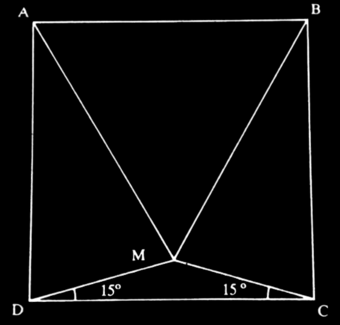
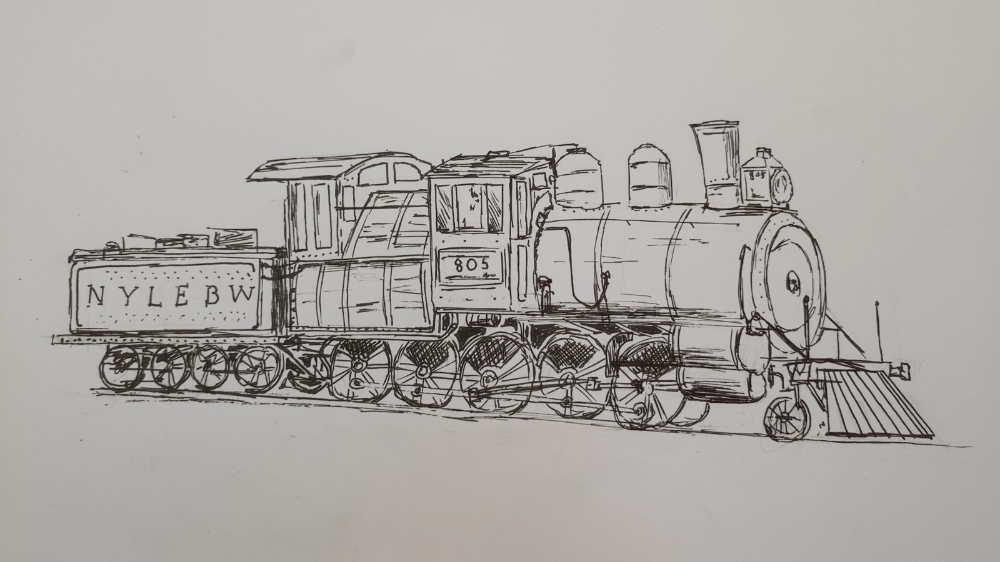
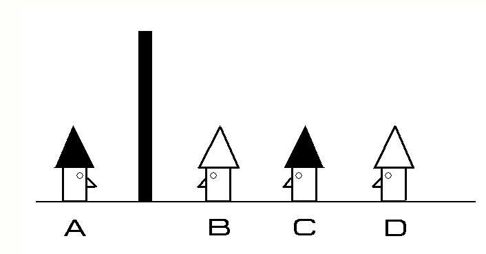

<Desafio numero={1} titulo="No quadrado" chave="No quadrado (15°)" fonte="Aventuras matemáticas, Miguel de Guzmán">

No quadrado $[ABCD]$, constrói o ponto $M$ tal como se indica na figura, desenhando $[MD]$ e $[MC]$ com um ângulo de 15° em relação a $[DC]$. Demonstra que o triângulo $[MAB]$ é equilátero.

Seja 1 o lado do quadrado e fixemos um referencial com $D = (0, 0)$, $C = (1, 0)$, $B = (1, 1)$ e $A = (0, 1)$. Por simetria, $M$ está na mediatriz de $[DC]$, à altura $h = \frac{1}{2}\tan 15^\circ$. Como $\tan 15^\circ = 2 - \sqrt{3}$,

$$
M = \left(\tfrac12,\ 1 - \tfrac{\sqrt3}{2}\right).
$$

Então

$$
\overline{MA}^2 = \left(\tfrac12\right)^2 + \left(1 - h\right)^2 = \tfrac14 + \left(\tfrac{\sqrt3}{2}\right)^2 = \tfrac14 + \tfrac34 = 1,
$$

logo $\overline{MA} = 1$ e, pela mesma simetria, $\overline{MB} = 1$. Como $\overline{AB} = 1$, o triângulo $[MAB]$ tem os três lados iguais: **é equilátero**.

*(Há também uma bela demonstração só com geometria sintética: constrói o triângulo equilátero $[ABN]$ para dentro do quadrado e mostra que $N$ coincide com $M$.)*

</Desafio>

<Desafio numero={2} titulo="Em viagem" resposta="45" unidade="km/h" fonte="Pierre Berloquin, 100 jogos numéricos, Gradiva">

Timóteo sai de Paris, viajando a velocidade constante. Passa por um marco que contém dois algarismos. Uma hora depois passa por outro marco, contendo os dois mesmos algarismos, mas numa ordem inversa. Uma hora depois passa por um terceiro marco, contendo os mesmos algarismos, separados por um zero. Qual é a velocidade a que vai?

Os marcos são $\overline{ab}$, $\overline{ba}$ e $\overline{a0b}$. Como a velocidade é constante, as distâncias percorridas em cada hora são iguais:

$$
(10b + a) - (10a + b) = (100a + b) - (10b + a) \iff 9b - 9a = 99a - 9b \iff b = 6a.
$$

Só $a = 1$, $b = 6$ serve: os marcos são 16, 61 e 106. A velocidade é $61 - 16 = $ **45 km/h**.

</Desafio>

<Desafio numero={3} titulo="O avô e o neto" resposta="66" unidade="anos (o avô)" fonte="Matemáticas recreativas, Y. Perelman">

O que vou contar sucedeu em 1932. A minha idade nesse ano era expressa pelo número formado pelos dois últimos algarismos do ano em que nasci. Ao dar conhecimento ao meu avô desta coincidência, ele deixou-me perplexo ao dizer-me que, com a idade dele, acontecia o mesmo. Isso pareceu-me impossível!

— Pois é perfeitamente possível — o meu avô demonstrou-mo.

Quantos anos tinha cada um de nós? (Indica a idade do avô.)

O neto nasceu em $19\overline{xy}$: $1932 - 1900 - \overline{xy} = \overline{xy}$, logo $\overline{xy} = 16$. O neto tinha **16 anos** (nasceu em 1916).

O avô nasceu em $18\overline{ab}$: $1932 - 1800 - \overline{ab} = \overline{ab}$, logo $\overline{ab} = 66$. O avô tinha **66 anos** (nasceu em 1866).

</Desafio>

<Desafio numero={4} titulo="Qual é o mais alto?" resposta="O primeiro" opcoes={['O primeiro', 'O segundo', 'Não é possível saber']} fonte="100 jogos lógicos, Pierre Berloquin">

Este problema apareceu na edição anterior mas tinha um erro no enunciado. Por esse motivo, propõe-se novamente o problema, agora com a sua formulação correta.

Um general tenta escolher um cozinheiro de entre 625 voluntários. Manda-os formar num quadrado de 25 filas (horizontal) e 25 colunas (vertical). Manda sair o mais alto de cada <u>coluna</u> e escolhe o mais baixo de entre eles. Depois muda de ideias. Fá-los regressar aos respetivos lugares, manda sair o mais pequeno de cada fila e escolhe o maior de entre eles.

Sendo diferentes os dois cozinheiros escolhidos, qual deles é o mais alto?

Seja $A$ o primeiro escolhido e $B$ o segundo, e seja $C$ o voluntário que está na coluna de $A$ e na fila de $B$. $A$ é o mais alto da sua coluna, logo $A \ge C$; $B$ é o mais baixo da sua fila, logo $C \ge B$. Assim $A \ge B$ e, sendo diferentes, **o primeiro é o mais alto**.

</Desafio>

## Puzzles lógicos

<Desafio numero={5} titulo="Problema dos prisioneiros ou dos chapéus" resposta="2|o 2|prisioneiro 2" fonte="Theo Choicoski, 12.º A">

Era uma vez 4 prisioneiros. O guarda avisa que todos eles serão libertados se pelo menos um responder corretamente qual é a cor do chapéu que está usando. Diz-lhes que dois dos chapéus são brancos e dois são pretos e que foram colocados aleatoriamente nas cabeças deles.

Eles não se podem mexer nem conversar entre eles, nem conseguem ver a cor do seu próprio chapéu. No entanto, conhecem as posições que ocupam. Só podem falar para dar a resposta (cor do seu chapéu). Estão numa sala, com um muro, que deixa três de um lado e um do outro, conforme a figura sugere.

- O 1 vê o chapéu do 2 e do 3.
- O 2 vê o chapéu do 3.
- O 3 só vê a parede.
- O 4 só vê a parede.

Qual deles pode falar e resolver o problema? (Indica o número.)

Se o 2 e o 3 tivessem chapéus da mesma cor, o 1 saberia logo que o seu era da outra cor e responderia. Como o 1 fica calado, o 2 conclui que o seu chapéu é **diferente** do chapéu do 3, que ele está a ver. Quem fala é o **prisioneiro 2**.

</Desafio>

### Puzzles lógicos de R. Smullyan

O matemático norte-americano Raymond Smullyan (1919–2017) teve uma vida notável, tendo-se destacado em várias áreas. Foi matemático, mágico, pianista, lógico e filósofo. No campo da Lógica, Smullyan divertiu-se a criar puzzles lógicos que muito enriqueceram esta área da Matemática explorando a potencialidade recreativa da matemática.

Smullyan inventou várias “realidades”. Smullyan pegou num problema muito antigo e, a partir dele, criou muitos outros em realidades alternativas. Um destes “mundos alternativos” é uma Ilha muito peculiar… a **Ilha dos Verdadeiros e dos Mentirosos**. Nesta ilha, os habitantes são de dois tipos: dizem sempre a verdade (Verdadeiros) ou mentem sempre (Mentirosos). Apresentam-se aqui três desses puzzles retirados do seu livro “Qual é o nome deste livro?”.

Nota que ninguém pode dizer de si próprio que é mentiroso: se for mentiroso, estará a dizer a verdade, o que contraria o facto de ser mentiroso; se for verdadeiro, estará a mentir.

<Desafio numero="6a" titulo="Problema 1" resposta="B é mentiroso e C é verdadeiro" opcoes={['B é verdadeiro e C é mentiroso', 'B é mentiroso e C é verdadeiro', 'Ambos são mentirosos', 'Ambos são verdadeiros']}>

Uma pessoa que estava de passagem encontra três habitantes da Ilha ($A$, $B$ e $C$) e pergunta ao $A$: “És Verdadeiro ou Mentiroso?” Não tendo compreendido a resposta dada por $A$, o forasteiro perguntou a $B$: “O que disse $A$?” $B$ respondeu: “$A$ disse que é mentiroso”. Neste momento, $C$ disse: “Não acredite no que $B$ lhe está a dizer; ele está a mentir!”

Qual é a natureza de $B$ e de $C$?

Como ninguém pode dizer de si próprio que é mentiroso, $A$ nunca o disse: $B$ **mentiu**, logo é mentiroso. Então $C$ disse a verdade: $C$ é **verdadeiro**. (Sobre $A$ nada se pode concluir.)

</Desafio>

<Desafio numero="6b" titulo="Problema 2" resposta="Ana é mentirosa e Bruno é verdadeiro" opcoes={['Ana é mentirosa e Bruno é verdadeiro', 'Ana é verdadeira e Bruno é mentiroso', 'Ambos são mentirosos', 'Não é possível concluir']}>

Certo dia, um forasteiro encontra dois habitantes desta ilha, a Ana ($A$) e o Bruno ($B$), e obtém a seguinte informação de um deles, a Ana: “somos ambos mentirosos”.

Será que o forasteiro pode concluir quem é mentiroso e quem é verdadeiro?

Se a Ana fosse verdadeira, seria mentirosa (pela sua frase) — impossível. Logo, a Ana é **mentirosa** e a frase é falsa: não são ambos mentirosos, por isso o Bruno é **verdadeiro**.

</Desafio>

<Desafio numero="6c" titulo="Problema 3" resposta="A é mentiroso, B é normal e C é verdadeiro" opcoes={['A é verdadeiro, B é mentiroso e C é normal', 'A é mentiroso, B é normal e C é verdadeiro', 'A é normal, B é verdadeiro e C é mentiroso', 'A é normal, B é mentiroso e C é verdadeiro']}>

<u>Noutra ilha</u>, os habitantes são de 3 tipos: verdadeiros, mentirosos ou normais. Os verdadeiros dizem sempre a verdade, os mentirosos mentem sempre e os normais umas vezes falam verdade e por vezes também mentem.

Um forasteiro encontra 3 habitantes desta ilha e tem a informação de que entre eles há um de cada tipo. Questionados sobre as suas naturezas respondem:

- $A$: Eu sou normal.
- $B$: É verdade (o que disse $A$).
- $C$: Eu não sou normal.

O que são $A$, $B$ e $C$?

- $A$ não é verdadeiro (um verdadeiro não diria que é normal).
- Se $A$ fosse normal, $B$ diria a verdade e $C$ seria o mentiroso; mas então “eu não sou normal” seria verdade, e um mentiroso não a diria. Logo $A$ **não é normal**: $A$ é **mentiroso**.
- Então $B$ disse uma falsidade, logo $B$ não é verdadeiro: $B$ é **normal**, e $C$ é **verdadeiro** (e de facto não é normal).

</Desafio>

Se quiseres enviar a(s) tua(s) resolução(ões), podes utilizar o endereço de email do jornal: <a href="mailto:maismatjornal@gmail.com">maismatjornal@gmail.com</a>.

