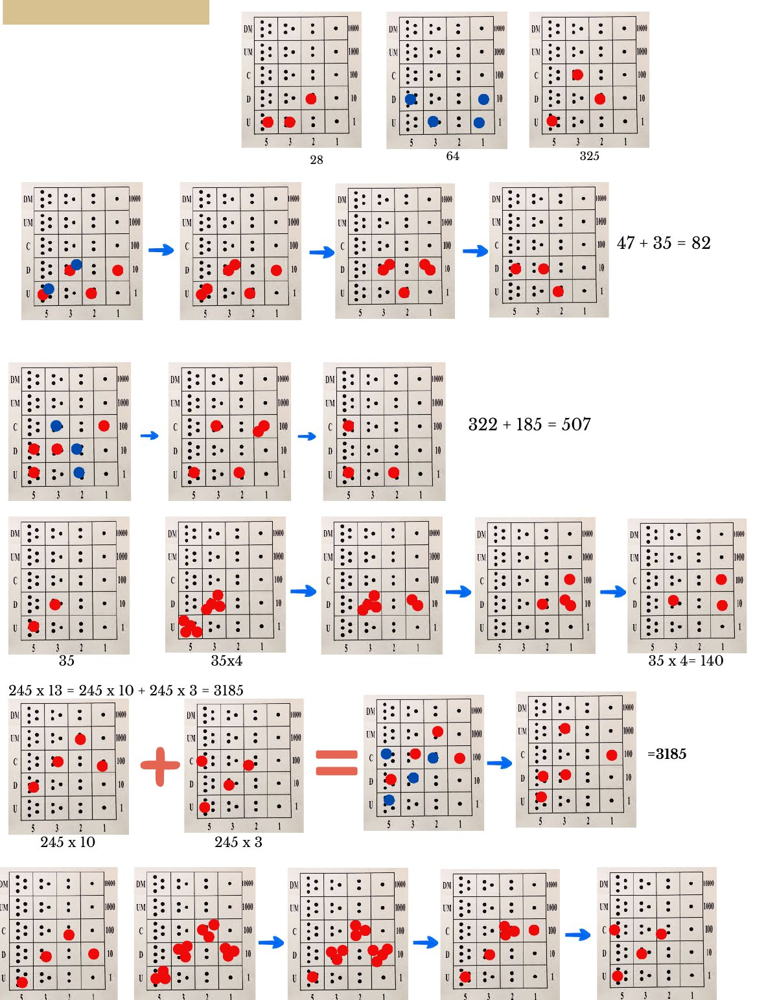

## Os cálculos no Yupana — ábaco inca

- Representação de 28, 64 e 325.
- $47 + 35 = 82$.
- $322 + 185 = 507$.
- $35 \times 4 = 140$.
- $245 \times 13 = 245 \times 10 + 245 \times 3 = 3185$.

## Desafios

### Problema 1 — 38 triângulos e 27 hexágonos

*100 jogos geométricos, Pierre Berloquin*

| Triângulos | | Hexágonos | |
| --- | :-: | --- | :-: |
| que ocupam 1 casa | 24 | que ocupam 6 casas | 19 |
| que ocupam 4 casas | 12 | que ocupam 24 casas | 7 |
| que ocupam 9 casas | 2 | que ocupam 54 casas | 1 |
| **Total** | **38** | **Total** | **27** |

### Problema 3 — economia doméstica

*Eduardo Veloso e José Paulo Viana, Desafios 3, Edições Afrontamento*

Quando se fala de percentagens surgem muitas vezes pequenas confusões e imprecisões que acabam em erros. Uma primeira questão é que a percentagem se relaciona sempre com uma quantidade tomada como referência.

Por exemplo, se um televisor custar 1500 € e outro 1200 €, pode dizer-se que o primeiro custa mais 25 % que o segundo. Neste caso, toma-se como referência o preço do segundo e, para calcular a percentagem, divide-se a diferença de preços (300 euros) por 1200: $300 : 1200 = 0{,}25$ ou 25 %. Mas se a referência for o primeiro televisor, é preciso dividir a diferença por 1500: $300 : 1500 = 0{,}20$ ou 20 %, e deve dizer-se que o segundo televisor é 20 % mais barato que o primeiro.

Vamos então ver agora como foram as compras da Ana Luzia. Sobre os detergentes, temos quatro informações: duas sobre os preços e outras duas sobre os pesos. Comecemos pelos preços.

Sabemos que NEV é 40 % mais caro que TIC. Para simplificar o nosso raciocínio, arbitremos um preço para a embalagem de TIC e que nos vai servir de referência: 100 €. Então NEV custa 140 €. Por outro lado, SOL é 20 % mais caro que NEV. A embalagem custará então 168 €: $140 \times 1{,}20 = 168$.

Analisemos agora os pesos. Arbitremos o valor 100 g para o peso da embalagem de TIC. Como a de SOL é 50 % mais pesada, o seu peso será 150 g. Sabemos também que a de NEV é 20 % mais leve que a de SOL, ou seja, pesará 80 % de 150: $150 \times 0{,}80 = 120$.

| | Preço | Peso | Preço por unidade de peso |
| --- | :-: | :-: | :-: |
| TIC | 100 | 100 | 1,00 |
| NEV | 140 | 120 | 1,17 |
| SOL | 168 | 150 | 1,12 |

Portanto, a embalagem mais económica é a de **TIC**, enquanto que o detergente NEV é o que acaba por ficar mais caro. Não sabemos como é que a Ana Luzia fez os cálculos, mas se os fez mentalmente damos-lhe os parabéns…

Passemos agora à questão do queijo. Pode parecer à primeira vista que, como o aumento percentual é exatamente igual à diminuição da quantidade comprada, a despesa se mantenha inalterada. Mas não é isso que se passa. Para se perceber melhor, pode admitir-se que ela comprava normalmente 10 queijinhos, cada um com o preço de 10 €. Gastava 100 €. Como os preços aumentaram 10 %, cada queijo passou a custar 11 €, e a Ana Luzia comprou menos 10 % que o habitual, ou seja, levou apenas 9. O preço que pagou foi então de $9 \times 11 = 99$ €. Acabou, portanto, por **gastar menos** do que costumava. Poupou exatamente 1 % (mas comeu muito menos queijo…).

Finalmente, uma pequena história que ilustra as confusões e erros a que as percentagens se prestam. Há alguns anos, um jornal diário titulava: «Impostos aumentam 15 %». No desenvolvimento da notícia informava que o imposto profissional tinha aumentado 5 % e o imposto complementar 10 %! Dois erros se cometem aqui.

Primeiro, só se podem somar percentagens se a referência for a mesma. Por exemplo, se passarmos 10 % do tempo a ler e 5 % a ver televisão, gastamos sem dúvida 15 % do nosso tempo nestas atividades. Podemos somar, porque a base para o cálculo é o mesmo: o tempo disponível. Segundo, se as percentagens têm como referência quantidades diferentes, nada se pode dizer sobre a percentagem final. Com efeito, imaginemos uma pessoa que pagasse 1000 € de imposto: 200 € de profissional e 800 € de complementar. Com o aumento, pagaria mais $200 \times 0{,}05 + 800 \times 0{,}10 = 90$ €. Outra pessoa que pagasse 800 e 200 euros, respetivamente, pagaria um excesso de $800 \times 0{,}05 + 200 \times 0{,}10 = 60$ €. Então, para a primeira pessoa, estes dois impostos teriam, no total, aumentado 9 % enquanto que para a segunda o aumento seria de 6 %.

## Múltiplos de 37

Ao multiplicarmos 37 pelos múltiplos de 3 menores do que 30, deparamo-nos com um facto curioso: dado que $3 \times 37 = 111$, se multiplicarmos 111 por 2, obtém-se 222, por 3, obtém-se 333, por 4, 444, e assim sucessivamente, até $9 \times 111 = 999$. Ora, esta regularidade equivale a multiplicar 37 por 3, 6, 9, 12, 15, 18, 21, 24 e 27, por esta ordem.

$$
\begin{aligned}
3 \times 37 &= 1 \times 3 \times 37 = 111 \\
6 \times 37 &= 2 \times 3 \times 37 = 222 \\
&\;\;\vdots \\
27 \times 37 &= 9 \times 3 \times 37 = 999
\end{aligned}
$$

Mais uma vez, aquilo que parece “magia” é, simplesmente, habilidade matemática!

<strong>Esperamos pelas tuas resoluções e sugestões! Até para o ano. Boas férias!</strong>

