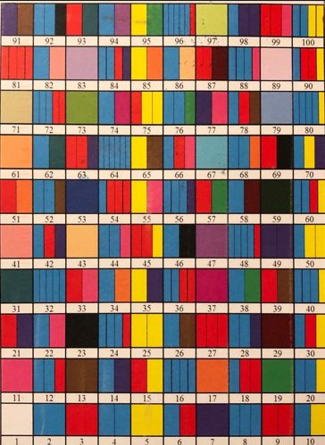

> *Todo o número inteiro positivo pode ser escrito como um produto de números primos.*

Esta ideia remonta a Euclides (300 a. C.), que o demonstrou no seu livro *Os Elementos*.

- 2 é primo → azul
- 3 é primo → vermelho
- 6 não é primo: $6 = 2 \times 3$ → azul e vermelho
- 9 não é primo: $9 = 3 \times 3$ → vermelho e vermelho

<Desafio id="desafio-155b63e3" titulo="Quantos números primos há na imagem?" resposta="25|vinte e cinco" unidade="primos">

Recorda que 1 não é primo.

Os números primos até 100 são: 2, 3, 5, 7, 11, 13, 17, 19, 23, 29, 31, 37, 41, 43, 47, 53, 59, 61, 67, 71, 73, 79, 83, 89 e 97 — são **25**. Na imagem, são as casas pintadas com uma única faixa de cor.

</Desafio>

<Desafio id="desafio-52f6a21a" titulo="Os dois números em falta">

Qual é a representação dos dois números em falta: 57 e 80?

- $57 = 3 \times 19$ → uma faixa vermelha (o 3) e uma faixa com a cor do 19.
- $80 = 2^4 \times 5 = 2 \times 2 \times 2 \times 2 \times 5$ → quatro faixas azuis (o 2) e uma faixa com a cor do 5.

</Desafio>
