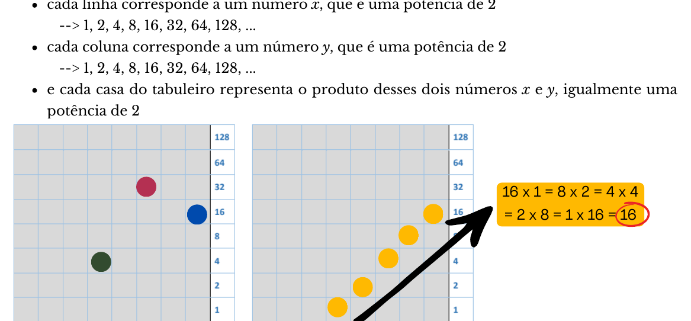
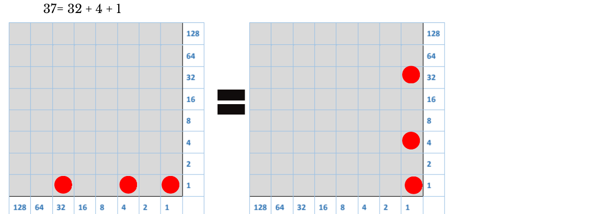
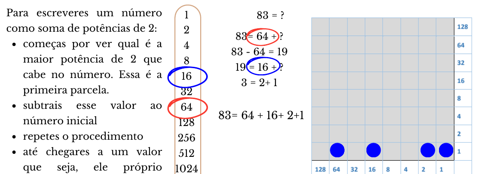
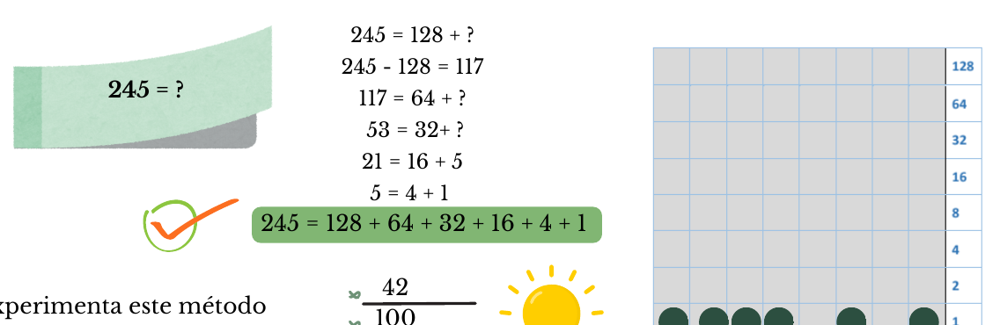
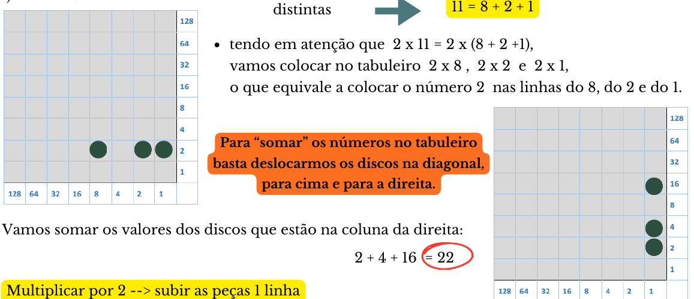
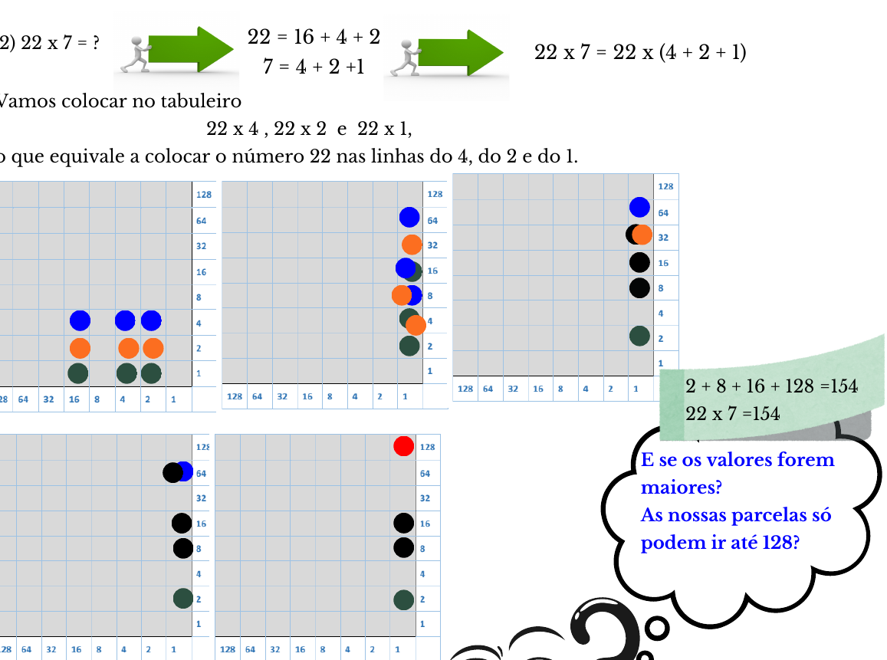
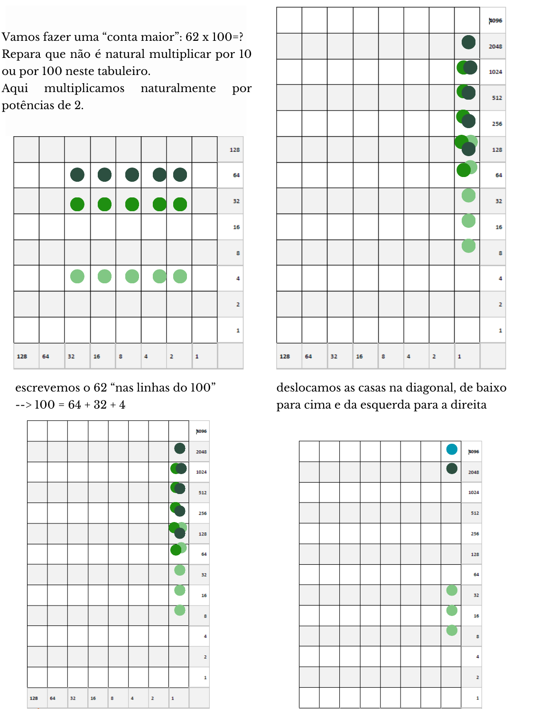

import Desafio from '../../../components/Desafio.astro';

John Napier, também conhecido por Neper, viveu em Edimburgo, na Escócia, entre 1550 e 1617. Foi um importante matemático, físico e astrónomo. Destacou-se em várias áreas da Matemática, sendo o seu trabalho mais relevante, provavelmente, a descoberta dos logaritmos. Relevante, também, é a constante com o seu nome: o número de Neper, que se representa pela letra $e$, e que é um número transcendente. Sobre a beleza desta constante, falaremos na próxima edição.

Agora vamos apresentar outra invenção deste fantástico matemático: o ábaco de Neper.

O ábaco de Neper consiste num tabuleiro de 8 linhas por 8 colunas (pode ter mais colunas ou mais linhas dependendo da ordem de grandeza dos números envolvidos):

- é uma tabela de dupla entrada;
- cada linha corresponde a um número $x$, que é uma potência de 2 → 1, 2, 4, 8, 16, 32, 64, 128, …
- cada coluna corresponde a um número $y$, que é uma potência de 2 → 1, 2, 4, 8, 16, 32, 64, 128, …
- e cada casa do tabuleiro representa o produto desses dois números $x$ e $y$, igualmente uma potência de 2.

Assim, cada casa do tabuleiro representa uma potência de 2, também. **Numa diagonal todos os números valem o mesmo:** o número pode “viajar” pela diagonal sem alterar o seu valor.

Podemos representar qualquer número inteiro positivo neste tabuleiro, atendendo à simplicidade da seguinte propriedade:

> **Propriedade:** todo o número inteiro positivo pode ser escrito como soma de potências de 2.

Por exemplo: $37 = 32 + 4 + 1$ e $83 = 64 + 16 + 2 + 1$.

Para escreveres um número como soma de potências de 2:

- começas por ver qual é a maior potência de 2 que cabe no número. Essa é a primeira parcela;
- subtrais esse valor ao número inicial;
- repetes o procedimento;
- até chegares a um valor que seja, ele próprio, potência de 2.

<Desafio titulo="Potências de 2">

Experimenta este método para escreveres os números 42, 100 e 338.

$42 = 32 + 8 + 2$; $100 = 64 + 32 + 4$; $338 = 256 + 64 + 16 + 2$ (em 338 a maior potência de 2 é 256; sobra 82; para 82, a maior é 64, e assim sucessivamente).

</Desafio>

## Vamos fazer umas contas!

**1) $2 \times 11 = {?}$** Escrevemos 11 como soma de potências de 2 distintas: $11 = 8 + 2 + 1$. Tendo em atenção que $2 \times 11 = 2 \times (8 + 2 + 1)$, vamos colocar no tabuleiro $2 \times 8$, $2 \times 2$ e $2 \times 1$, o que equivale a colocar o número 2 nas linhas do 8, do 2 e do 1.

**Para “somar” os números no tabuleiro basta deslocarmos os discos na diagonal, para cima e para a direita.** Vamos somar os valores dos discos que estão na coluna da direita: $2 + 4 + 16 = 22$.

- Multiplicar por 2 → subir as peças 1 linha.
- Multiplicar por 4 → subir as peças 2 linhas.

**2) $22 \times 7 = {?}$** $22 = 16 + 4 + 2$ e $7 = 4 + 2 + 1$, logo $22 \times 7 = 22 \times (4 + 2 + 1)$. Vamos colocar no tabuleiro $22 \times 4$, $22 \times 2$ e $22 \times 1$, o que equivale a colocar o número 22 nas linhas do 4, do 2 e do 1.

E se os valores forem maiores? As nossas parcelas só podem ir até 128? **Não! Basta construir um tabuleiro maior.**

**Vamos fazer uma “conta maior”: $62 \times 100 = {?}$** Repara que não é natural multiplicar por 10 ou por 100 neste tabuleiro. Aqui multiplicamos naturalmente por potências de 2. Escrevemos o 62 “nas linhas do 100” ($100 = 64 + 32 + 4$), deslocamos as casas na diagonal, de baixo para cima e da esquerda para a direita, e simplificamos o tabuleiro: **duas peças numa casa = uma peça na casa de cima**.

Com este tabuleiro podemos fazer multiplicações de forma simples! Fazendo adições.

<Desafio titulo="Constrói um tabuleiro" resposta="169" unidade="(resultado de 13 × 13)">

Constrói um tabuleiro destes e faz $16 \times 20$ e $13 \times 13$.

- $20 = 16 + 4$: escrever o 20 na linha do 16: $16 \times 20 = 64 + 256 = 320$.
- $13 = 8 + 4 + 1$: escrever o 13 nas linhas do 8, do 4 e do 1, deslocar os discos na diagonal e simplificar: $13 \times 13 = (8 + 4 + 1) \times (8 + 4 + 1) = 1 + 8 + 32 + 128 = 169$.

</Desafio>
