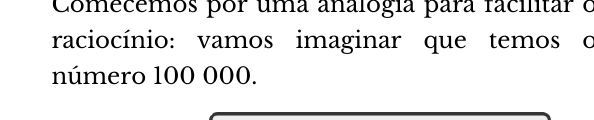
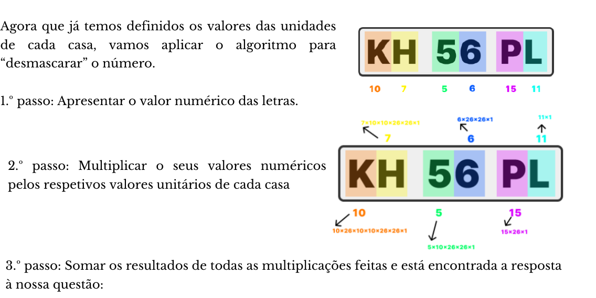

import Desafio from '../../../components/Desafio.astro';

Pode parecer um pouco estranho, mas, na verdade, o conjunto de letras e números que constituem a matrícula de um veículo, quando combinados através de um algoritmo, dão origem a um número. Esta combinação de caracteres, ou melhor, este número, é utilizado para identificar o veículo, conferindo-lhe uma identificação única.

Então porque é que a matrícula não apresenta diretamente o número? Esta é uma pergunta a que é muito fácil responder. De acordo com a Pordata, em 2022, circulavam, em Portugal, aproximadamente, 7 249 033 veículos. Já imaginaste se tivéssemos que ler todos esses números por extenso? Quão difícil seria lembrarmo-nos de uma matrícula? A combinação de caracteres “encurta” o tamanho da identificação, facilitando a sua leitura, além de a tornar intuitiva.

Depois desta breve introdução, vamos colocar as mãos na massa. O padrão das matrículas automóveis, em Portugal, consiste em 2 grupos de letras (AZUL) e 1 grupo de números (AMARELO), alternados entre si.

Cada algarismo do grupo de letras possui 26 possibilidades de combinação diferentes, sendo estas de A a Z. Cada um deles corresponde a um valor numérico que varia entre 0 e 25 (A → 0, B → 1, C → 2, …, Z → 25). Cada algarismo do grupo de números possui 10 possibilidades de combinação diferentes, sendo estas de 0 a 9.

Para calcularmos as possibilidades totais de matrículas únicas, basta multiplicarmos as possibilidades de cada caracter:

$$
26 \times 26 \times 10 \times 10 \times 26 \times 26 = 45\,697\,600
$$

## Desmascarar o número

O algoritmo para calcular o número que está “mascarado” pela matrícula é bastante simples. Vamos tomar como exemplo a matrícula **KH 56 PL**.

Comecemos por uma analogia para facilitar o raciocínio: vamos imaginar que temos o número 100 000. Sabemos que 1 centena de milhar corresponde a 100 000 unidades, 1 unidade de milhar corresponde a 1000 unidades e 1 dezena corresponde a 10 unidades. Seguindo o mesmo princípio, vamos aplicar esta lógica ao algoritmo da matrícula.

A cada casa corresponde um número (denominado aqui por *valor unitário da casa*) que é igual a 1 multiplicado pelo número de possibilidades de cada uma das casas que se lhe seguem (à direita). Por exemplo, à casa onde está o algarismo 5 corresponde o produto $1 \times 10 \times 26 \times 26$.

| Casa | Valor em unidades |
| --- | --- |
| 1.ª letra | $26 \times 10 \times 10 \times 26 \times 26$ |
| 2.ª letra | $10 \times 10 \times 26 \times 26$ |
| 1.º algarismo | $10 \times 26 \times 26$ |
| 2.º algarismo | $26 \times 26$ |
| 3.ª letra | $26$ |
| 4.ª letra | $1$ |

1. **Apresentar o valor numérico das letras:** K → 10, H → 7, P → 15, L → 11.
2. **Multiplicar os seus valores numéricos pelos respetivos valores unitários de cada casa.**
3. **Somar os resultados de todas as multiplicações** e está encontrada a resposta à nossa questão:

$$
10 \times 26 \times 10 \times 10 \times 26 \times 26 + 7 \times 10 \times 10 \times 26 \times 26 + 5 \times 10 \times 26 \times 26 + 6 \times 26 \times 26 + 15 \times 26 + 11 = 18\,087\,457
$$

**KH · 56 · PL → 18 087 457**

## Já consegues descodificar a matrícula de um veículo?

**Qual será o número correspondente à matrícula AA-00-AA?** Corresponde o número 0. Repara que tanto o A como o 0 correspondem ao algarismo 0 (zero), que vai anular todas as parcelas.

Se alterares apenas a última letra para B, terás o número 1 (AA-00-AB). Se a alterares para C, terás o 2; para D, o 3, e assim sucessivamente, até ao Z, para a qual terás o número 25. Ou seja, a alteração da última letra dá-nos 26 matrículas diferentes. Se alterarmos apenas a penúltima letra, vamos ter 26 matrículas, também. E, para cada uma destas, temos as 26 matrículas explicadas antes. Assim, as possibilidades para as duas últimas letras dão $26 \times 26 = 676$ matrículas.

**Qual será o número correspondente à matrícula ZZ-99-ZZ?**

$$
25 \times 26 \times 10 \times 10 \times 26 \times 26 + 25 \times 10 \times 10 \times 26 \times 26 + 9 \times 10 \times 26 \times 26 + 9 \times 26 \times 26 + 25 \times 26 + 25 = 45\,697\,599
$$

Repara que é a última matrícula deste tipo, o que, como vimos inicialmente, nos dá um total de **45 697 600 matrículas possíveis**.

<Desafio titulo="A matrícula CD-45-FX" resposta="3748573|3 748 573">

Qual será o número correspondente à matrícula CD-45-FX?

C → 2, D → 3, F → 5, X → 23:

$$
2 \times 1\,757\,600 + 3 \times 67\,600 + 4 \times 6760 + 5 \times 676 + 5 \times 26 + 23 = 3\,748\,573.
$$

</Desafio>

<Desafio titulo="E ao contrário?">

Consegues descobrir um algoritmo para converter um número numa matrícula?

É o processo inverso, com divisões inteiras sucessivas (como quando se converte um número para outra base). Por exemplo, para 18 087 457:

- $18\,087\,457 \div 26$ dá quociente 695 671 e **resto 11** → L (última letra);
- $695\,671 \div 26$ dá quociente 26 756 e **resto 15** → P;
- $26\,756 \div 10$ dá quociente 2675 e **resto 6** → 6;
- $2675 \div 10$ dá quociente 267 e **resto 5** → 5;
- $267 \div 26$ dá quociente 10 e **resto 7** → H;
- o último quociente, **10**, é a primeira letra → K.

Lendo de baixo para cima: **KH-56-PL**.

</Desafio>
