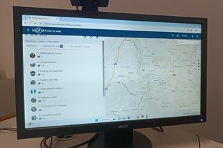
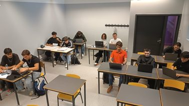
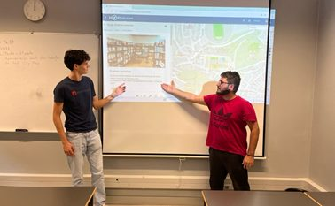
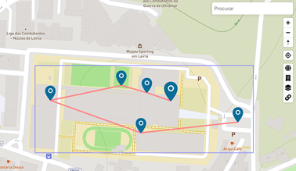

Um trilho matemático é um percurso fora da sala de aula, em que é necessário passar por determinados locais e responder a questões ou resolver problemas. Ao longo do trilho, os participantes contactam com tarefas propostas em contexto real, as quais ilustram a utilidade da matemática e ampliam a possibilidade de se estabelecer conexões entre esta disciplina e a realidade.

Este tipo de trilho pode ser realizado em papel ou em formato digital, usando, por exemplo, o recurso tecnológico MathCityMap, produto do grupo de trabalho MATIS I (IDMI, Goethe — Universität Frankfurt a.M.). Esta aplicação gratuita é constituída por dois ambientes: um portal ([mathcitymap.eu/pt](https://mathcitymap.eu/pt/)), no qual são criados os trilhos e as tarefas, usando ferramentas matemáticas (Figura 1); e uma aplicação para *smartphones* e *tablets*. Ao usar esta aplicação, o utilizador dirige-se a um local indicado num mapa, através de localização GPS, onde é desafiado a responder a uma questão matemática. Quando responde corretamente, ganha pontos e visualiza o local seguinte no mapa, com uma nova tarefa. A aplicação possui opções de gaming que tornam a resolução de tarefas mais motivadora.

## MathCityMap no âmbito das probabilidades

No final do mês de setembro de 2024, no âmbito do módulo A7 — Probabilidades, os alunos da turma A do 3.º ano do curso Técnico de Electrotécnia foram desafiados para criar o primeiro trilho matemático na Escola Secundária Domingos Sequeira.

Os 12 alunos organizaram-se em 6 pares e escolheram 6 locais para explorar, do ponto de vista das probabilidades: a biblioteca, o bar, o campo do basquetebol, o pavilhão desportivo, o bloco A e o parque de estacionamento.

No dia 4 de outubro, durante a aula de Matemática (Figura 2), cada equipa deslocou-se ao local selecionado, munida de um guião fornecido pelo professor, e redigiu três propostas de tarefas acompanhadas da respetiva resolução. Seguidamente, após um período de revisão, os alunos digitalizaram as tarefas no portal MathCityMap, acrescentando diversas informações, nomeadamente “Sugestões passo a passo” para ajudar os participantes a responder às questões.

No dia 14 de outubro, cada grupo apresentou as suas tarefas à turma e indicou a tarefa que recomendava para integrar o trilho (Figura 3). Posteriormente, já em novembro, foi criado o trilho e sujeito a novo processo de revisão. Neste momento, o trilho “Probabilidades na ESDS” está disponível para toda a comunidade escolar (Figura 4)!

## Como experimentar o trilho “Probabilidades na ESDS”?

É muito simples! Segue as etapas seguintes:

1. Instala a aplicação (gratuita) MathCityMap no teu telemóvel, a partir da Play Store ou da App Store. Durante a instalação, deverás autorizar a localização.
2. Seleciona “Procurar trilhos” e escreve (na parte superior) o código **0823729**.
3. Seleciona “Download Trail” (na parte inferior) e, após a transferência, “Iniciar trilho”.
4. À pergunta “Quer começar a partir de uma determinada tarefa?”, responde “Sim” e escolhe a primeira tarefa: “#1 Computador avariado”.
5. Chegando ao local (a biblioteca), seleciona “Ir para a tarefa” (na parte inferior).
6. Responde à pergunta e seleciona “Verificar”. Se a resposta estiver correta, seleciona “Próxima tarefa” e prossegue para a etapa seguinte; caso contrário, tenta novamente.

Em cada questão, podes usar duas “Sugestões”, selecionando os ícones com lâmpadas. No fim, podes ainda consultar a resolução da tarefa, selecionando “Exemplo de solução”.

