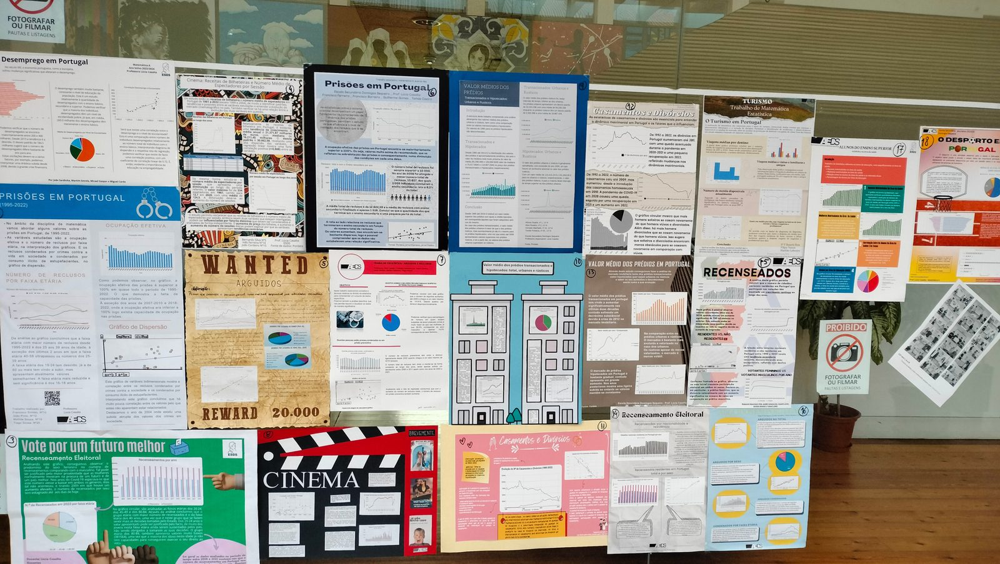
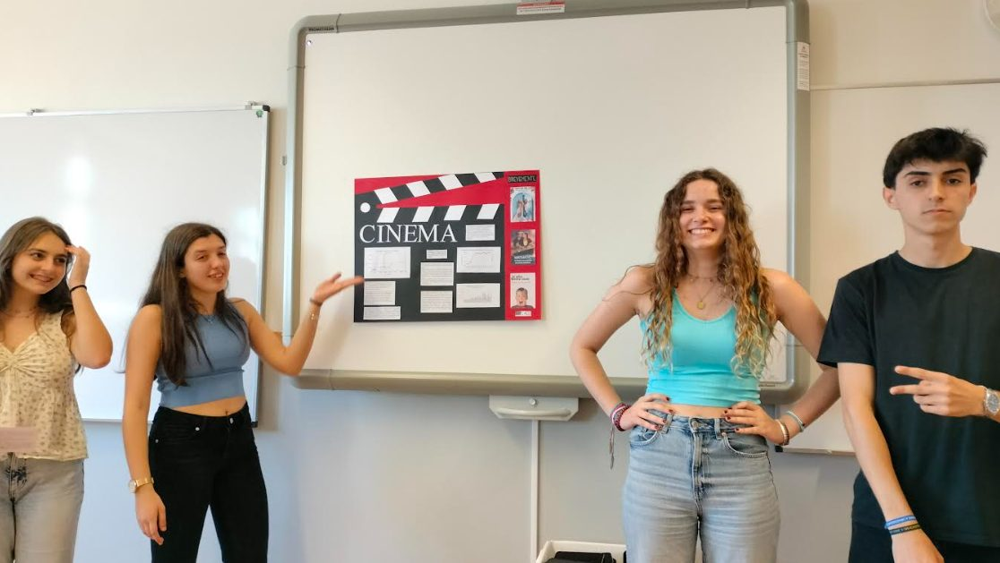

No ano letivo transato, os alunos do 11.º ano, turmas A, B e I, realizaram, no âmbito da disciplina de Matemática, um estudo estatístico abordando vários temas da atualidade: cinema, desporto, desemprego, turismo, prisões em Portugal, valores habitacionais, entradas no ensino superior (por género), etc.

“A metodologia de trabalho foi a da colaboração entre pares, permitindo que os alunos aprendessem através da pesquisa, da partilha, da reflexão e da produção de materiais. Os resultados foram muito positivos dado o empenho e interesse revelado pelos alunos. Após as apresentações orais realizadas em contexto de aula, foi feita uma exposição no átrio da escola com o intuito de premiar os olhos de todos os elementos da comunidade educativa com o bom trabalho desenvolvido.”

Por fim, os alunos destas 3 turmas participaram na eleição do melhor cartaz, tendo sido vencedor o cartaz elaborado pelos alunos Carolina Viana, Constança Ferreira, Diogo Gomes e Filipa Moita, com o tema “Cinema”.

Na próxima edição do jornal revelaremos trabalhos elaborados por alunos de outras turmas.

