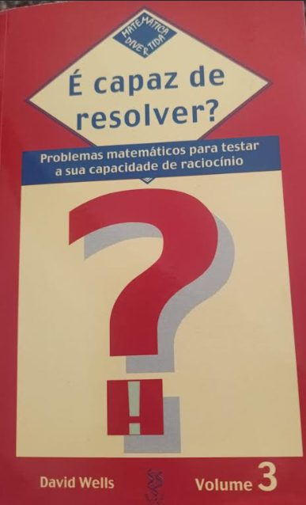
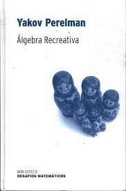
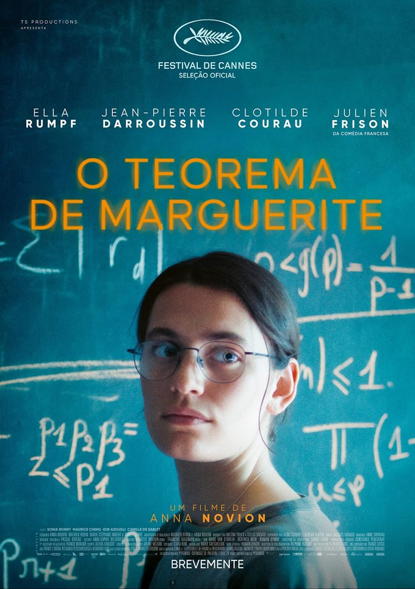
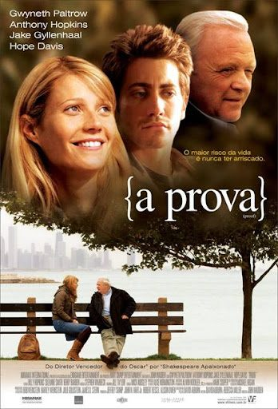

Quase a finalizar esta edição, deixamos-te algumas sugestões de leituras e de filmes. Os livros que propomos estão ambos disponíveis em *pdf* online. Os dois filmes sugeridos podem ser vistos também online. Se tiveres interesse, contacta a BECRE. Envia-nos os teus comentários.

## Livros

## Filmes

<strong>Por agora, é só!</strong> Mas não terminamos esta edição sem antes apresentarmos as resoluções de todos os desafios da edição anterior!

