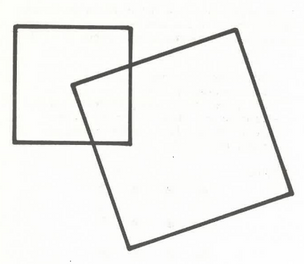

<Desafio id="desafio-e58e8f1c" numero={1} titulo="Quantas girafas e quantas avestruzes?" resposta="7|sete" unidade="girafas" fonte="Ah, descobri!, Martin Gardner">

Antes de saírem do parque, Bob e Helen atravessaram o Jardim Zoológico. Numa jaula viram uma mistura de girafas e de avestruzes. Depois de terem saído, Bob falou com Helen:

— Contaste as girafas e as avestruzes? 
— Não, quantas eram? 
— Descobre tu. Ao todo, tinham 30 olhos e 44 pés.

Quantas girafas havia?

Com $x$ girafas e $y$ avestruzes: $2x + 2y = 30$ e $4x + 2y = 44$, logo $x = 7$ e $y = 8$. **7 girafas e 8 avestruzes.**

</Desafio>

<Desafio id="desafio-6df0276a" numero={2} titulo="No quadrado" resposta="0.25" casas={2} unidade="m²" fonte="100 jogos geométricos, Pierre Berloquin">

O quadrado pequeno tem 1 m de lado e o grande 1,5 m. Este tem um dos vértices no centro do quadrado pequeno. O lado do quadrado grande corta o lado do pequeno ao terço do seu comprimento.

Qual é a superfície da parte comum dos dois quadrados? (Responde em m², em número decimal.)

Rodando o quadrado grande em torno do seu vértice (que está no centro do pequeno), a região comum transforma-se num quadrado que ocupa exatamente um quarto do quadrado pequeno — e a área não muda com a rotação. A parte comum tem **$\frac{1}{4}$ m² = 0,25 m²**. A resolução completa foi publicada na [edição seguinte](/edicoes/ano3-edicao3/11-resolucoes/).

</Desafio>

## Desafios lógicos — na Selva de R. Smullyan

- O Leão (L) mente às segundas, terças e quartas, dizendo sempre a verdade nos outros dias.
- O Unicórnio (U) mente às quintas, sextas e sábados, dizendo sempre a verdade nos outros dias.

<Desafio
  id="desafio-216d121a"
  numero="3a"
  titulo="O Leão sozinho (edição anterior, corrigido)"
  resposta="Segunda-feira"
  opcoes={['Segunda-feira', 'Terça-feira', 'Quarta-feira', 'Quinta-feira', 'Sexta-feira', 'Sábado', 'Domingo']}
>

*Devido a um erro no enunciado do problema 2 da edição anterior, voltamos a colocar o problema, com a sua formulação correta.*

Numa ocasião, a Alice encontrou o Leão sozinho. Ele fez as seguintes afirmações:

- “Ontem foi dia de eu mentir.”
- “Vou mentir daqui a 3 dias.”

Em que dia da semana estamos?

A primeira frase só pode ser dita pelo Leão à segunda ou à quinta-feira. À quinta, o Leão diz a verdade, mas daqui a 3 dias é domingo, dia em que não mente: a segunda frase seria falsa, logo não a podia dizer. À segunda, o Leão mente, e daqui a 3 dias é quinta, dia em que não mente: a frase é falsa, como deve ser. Logo é **segunda-feira**.

</Desafio>

<Desafio
  id="desafio-beca9ffa"
  numero="3b"
  titulo="O Leão e o Unicórnio"
  resposta="Quinta-feira"
  opcoes={['Segunda-feira', 'Terça-feira', 'Quarta-feira', 'Quinta-feira', 'Sexta-feira', 'Sábado', 'Domingo']}
>

Numa ocasião, a Alice encontrou o Leão e o Unicórnio, que lhe disseram:

- U: “Ontem foi dia de eu mentir.”
- L: “Amanhã vou dizer a verdade.”

Em que dia da semana estamos?

O Unicórnio só pode dizer a sua frase ao domingo ou à quinta-feira. O Leão pode dizer a sua frase todos os dias exceto quarta e domingo. Logo é **quinta-feira**.

</Desafio>
