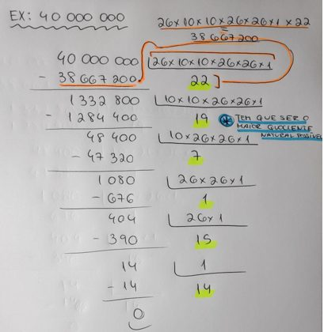
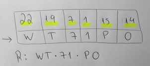
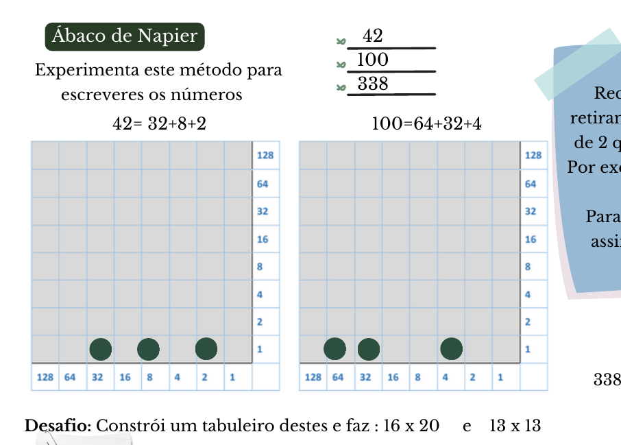
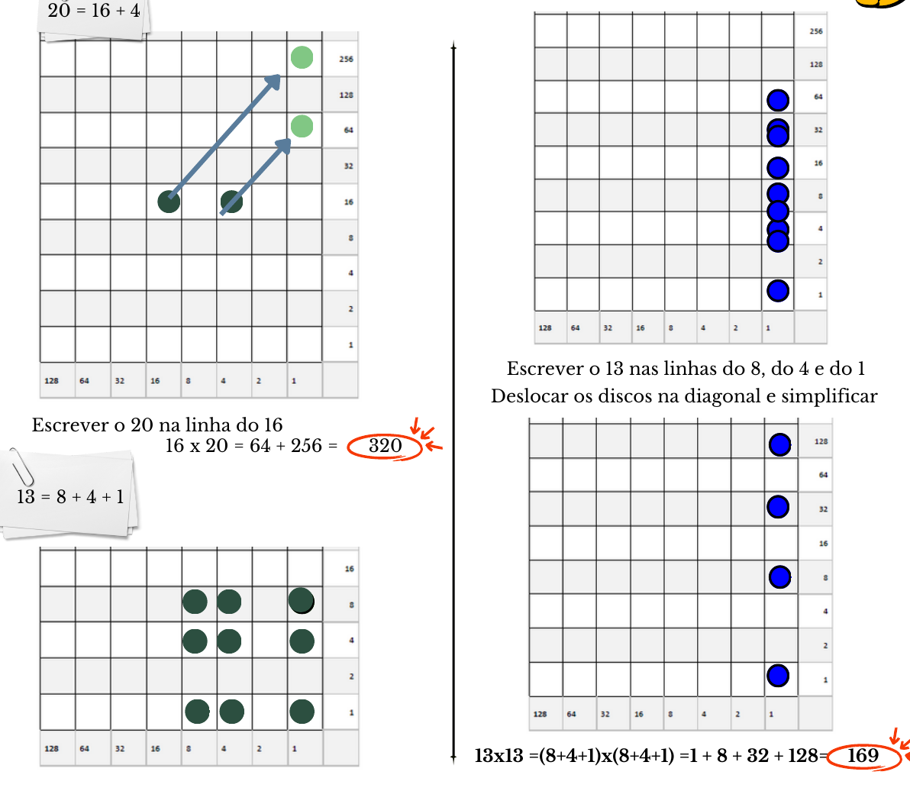

## Fatorização colorida

Qual é a representação dos dois números em falta: 57 e 80?

- $57 = 19 \times 3$ → 1 fator verde (o 19) e outro vermelho (o 3).\*
- $80 = 2 \times 2 \times 2 \times 2 \times 5$ → 5 fatores: 4 azuis e 1 amarelo.

<small>\* Na versão em papel lia-se “57 = 29 × 3”; corrigimos na versão digital.</small>

## Combinatória — matrículas

*Trabalho do aluno Miguel Rocha, 12.º G*

**E qual será o número correspondente à matrícula CD-45-FX?** Recorda que à letra A corresponde o número 0, à letra B o 1, à C o 2, e assim sucessivamente, até à letra Z, à qual corresponde o número 25. O número correspondente à matrícula CD-45-FX será igual ao somatório dos produtos das equivalências das letras/números, em números naturais, com o valor de cada posição da matrícula. Ou seja,

$$
2 \times 26 \times 10 \times 10 \times 26 \times 26 + 3 \times 10 \times 10 \times 26 \times 26 + 4 \times 10 \times 26 \times 26 + 5 \times 26 \times 26 + 5 \times 26 + 23 = 3\,748\,573
$$

**CD-45-FX → 3 748 573**

**Qual será a matrícula correspondente a um número dado?** Vejamos um exemplo, com 40 000 000: dividimos sucessivamente pelos valores de cada casa, da esquerda para a direita, e ficamos com os quocientes 22, 19, 7, 1, 15 e 14, ou seja, **WT-71-PO**.

## Desafios

### 1) Festa à noite

*Álgebra Recreativa, Yakov Perelman*

Consideremos que a Maria é a 1.ª rapariga.

| Raparigas | Rapazes | N.º alunos |
| :-: | :-: | :-: |
| 1.ª | 7 | 8 |
| 2.ª | 8 | 10 |
| 3.ª | 9 | 12 |
| 4.ª | 10 | 14 |
| 5.ª | 11 | 16 |
| 6.ª | 12 | 18 |
| 7.ª | 13 | **20** |

**Havia 13 rapazes.**

### 2) No círculo

*É capaz de resolver?, David Wells*

É possível encontrar o seu centro utilizando apenas um esquadro de forma muito simples: marcando um ângulo reto inscrito na circunferência, ficamos com um diâmetro; repetindo o processo obtemos outro diâmetro e a interseção dos dois é o centro da circunferência!

### 3) O problema dos pães

*O homem que sabia contar, Malba Tahan*

Sim, ele tem razão, pois os 8 pães foram comidos em partes iguais pelos 3 viajantes. Então os 8 pães foram partidos em 24 pedaços, uma vez que cada pão foi dividido em 3 pedaços, um para cada viajante, sendo que cada um comeu 8 pedaços. O viajante que contribuiu com 5 pães ($5 \times 3 = 15$ pedaços) comeu 8 pedaços e deu 7 pedaços ao rico mercador, tendo direito, por isso, a receber 7 moedas de ouro. Já o viajante que apenas contribuiu com 3 pães ($3 \times 3 = 9$ pedaços) comeu também 8 pedaços, tendo apenas dado 1 pedaço ao rico mercador e, por esse motivo, deve apenas receber 1 moeda de ouro.

### 4) Desafios lógicos — na Selva de R. Smullyan

Um dia Alice encontrou o Leão e o Unicórnio descansando à sombra de uma árvore e eles lhe disseram:

- L: Ontem foi um dos meus dias de mentir.
- U: Ontem foi um dos meus dias de mentir, também.

A Alice descobriu o dia da semana — era uma quinta-feira! Porquê?

| | Dom | Seg | Ter | Qua | Qui | Sex | Sáb |
| --- | :-: | :-: | :-: | :-: | :-: | :-: | :-: |
| Leão | V | M | M | M | V | V | V |
| Unicórnio | V | V | V | V | M | M | M |

A frase “ontem foi dia de eu mentir” podia ter sido proferida pelo Leão à segunda ou à quinta-feira, e pelo Unicórnio ao domingo ou à quinta-feira.

## Ábaco de Napier

Recorda que deves ir retirando a maior potência de 2 que cabe no número. Por exemplo, em 338 é 256. Sobra 82. Para 82, a maior é 64, e assim sucessivamente: $338 - 256 = 82$; $82 - 64 = 18$; $18 - 16 = 2$; $338 = 256 + 64 + 16 + 2$.

**Desafio: constrói um tabuleiro destes e faz $16 \times 20$ e $13 \times 13$.**

- $20 = 16 + 4$. Escrever o 20 na linha do 16: $16 \times 20 = 64 + 256 = 320$.
- $13 = 8 + 4 + 1$. Escrever o 13 nas linhas do 8, do 4 e do 1, deslocar os discos na diagonal e simplificar: $13 \times 13 = (8 + 4 + 1) \times (8 + 4 + 1) = 1 + 8 + 32 + 128 = 169$.
