Da Madeira a Brasília, há edifícios em que a Geometria não está escondida nos cálculos do arquiteto: está na própria forma. Consegues identificar os sólidos e as curvas em cada um destes exemplos?

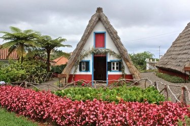

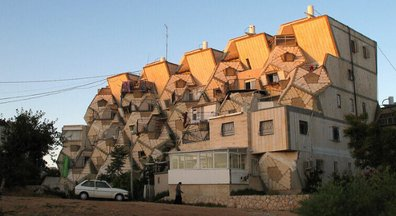

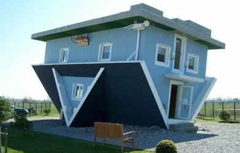

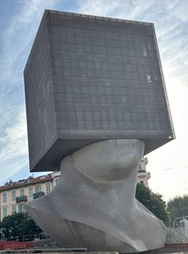

 teve, até 2019, o recorde mundial do Guinness para a rua mais íngreme do mundo.")

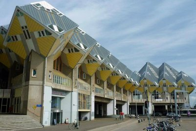

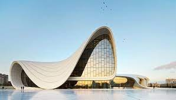

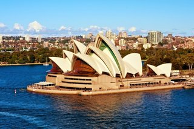

## Brasília, a cidade geométrica

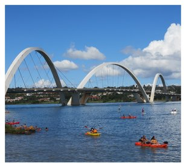

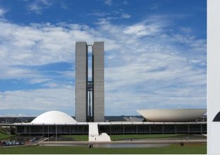

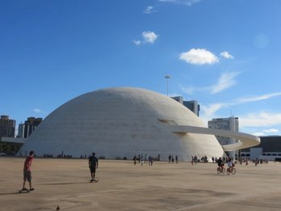

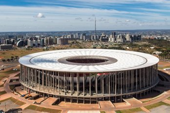

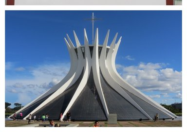

