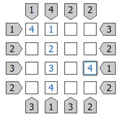
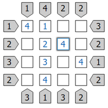
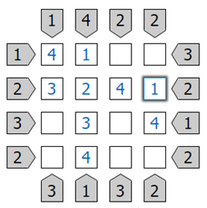
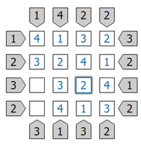
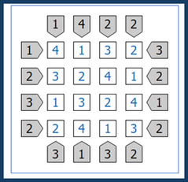
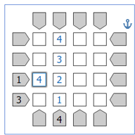
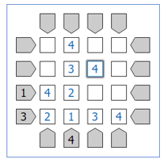
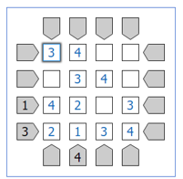
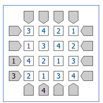

import ArranhaCeus from '../../../components/ArranhaCeus.astro';

Este jogo consiste num puzzle lógico e joga-se numa grelha 4×4. As regras são simples.

O objetivo é posicionar 16 arranha-céus na grelha, um em cada quadrado; a altura dos arranha-céus é de 1 até 4 (quatro de cada uma). O preenchimento da grelha tem de cumprir as seguintes regras:

- em cada linha e em cada coluna têm de estar 4 arranha-céus de alturas 1, 2, 3 e 4;
- não se pode ter dois arranha-céus com a mesma altura na mesma linha ou coluna;
- os números que estão dos lados, em cima e em baixo da grelha indicam quantos arranha-céus uma pessoa conseguiria ver se estivesse nessa posição a olhar para essa fila ou coluna de arranha-céus (lembra-te de que estes números vão de 1 a 4).

**Breve explicação dos números laterais.** Na primeira linha de cima, por exemplo, uma pessoa colocada à esquerda vê à sua frente 1 prédio, apenas, e outra que esteja à direita vê 3. Isto explica os dois números nas extremidades da linha. Na 2.ª coluna da esquerda, as extremidades têm os números 4 e 1: isto significa que a pessoa de cima vê 4 prédios à sua frente e a de baixo vê apenas 1.

## Algumas notas prévias

1. Supõe que a posição dos arranha-céus é a da figura acima. Alguém colocado do lado esquerdo vê apenas o prédio mais alto (vê 1 prédio) e alguém do lado direito vê os 4 prédios. Ver 1 e ver 4 prédios dá obrigatoriamente esta situação. É o que se verifica na 2.ª coluna do jogo.
2. Se a pessoa da esquerda vir 3 prédios, podes de imediato concluir que o prédio de 4 metros não pode ser o primeiro nem o segundo, porque iria esconder os prédios mais baixos.
3. Uma pessoa à esquerda e outra à direita podem ver ambas 3 prédios? Claro que não, visto que para cada uma delas o prédio de 4 tem de ser o 3.º ou o 4.º, o que não nos dá uma situação possível.
4. A pessoa da esquerda pode ver 3 prédios e a da direita 2? Pela da esquerda, o prédio mais alto tem de ser o 3.º ou o 4.º. Mas, se fosse o 4.º, quem estivesse à direita só veria esse prédio, o que não acontece, porque vê 2. Logo, o 4 tem de ser o 3.º da esquerda. À direita pode estar qualquer um dos prédios que faltam (a pessoa verá 2 prédios). À esquerda pode estar 1 2 4 ou 2 3 4. Neste caso temos 2 soluções possíveis para essa linha: 1 2 4 3 ou 2 3 4 1.

Há outras situações especiais que deverás identificar!

## Vamos jogar!

<ArranhaCeus titulo="Jogo 1" cima={[1, 4, 2, 2]} baixo={[3, 1, 3, 2]} esquerda={[1, 2, 3, 2]} direita={[3, 2, 1, 2]} />

Ver a resolução passo a passo do Jogo 1

Podemos preencher já algumas casas:

- quem vê 1 prédio vê o de 4 metros;
- se alguém vê 4 prédios (todos), estes têm de estar por ordem crescente de alturas.

**Na 2.ª linha (de cima):** falta colocar um prédio de 4 m, que será obrigatoriamente na 3.ª coluna; faltam o 1 e o 3. Se colocássemos o 1 no 1.º lugar, a pessoa que está à esquerda veria 3 edifícios, o que não se verifica. Assim, esta linha terá de ser 3 2 4 1.

**Na 4.ª coluna:** falta colocar o 2 e o 3 e a ordem parece indiferente, se pensarmos que quem está em cima e quem está em baixo vê 2 prédios. Mas, se a coluna fosse, de cima para baixo, 3 1 4 2, a 1.ª linha terminaria em 3, e alguém colocado à direita só veria 2 prédios, o de 3 m e o de 4 m. Não é isto que sucede; logo, a 4.ª coluna terá de ser 2 1 4 3.

**Na 1.ª linha** fica apenas um elemento em falta: o 3.

**Na 3.ª coluna:** a pessoa de baixo vê 3 prédios, um deles é o 4, e falta colocar apenas dois números: 1 e 2. Assim, esta coluna terá de ser 3 4 2 1.

O jogo está praticamente feito, porque basta completar as duas últimas linhas com o elemento que lhes falta.

## Vamos jogar outro jogo

Neste jogo há menos informação, mas ainda se faz bem!

<ArranhaCeus titulo="Jogo 2" cima={[0, 0, 0, 0]} baixo={[0, 4, 0, 0]} esquerda={[0, 0, 1, 3]} direita={[0, 0, 0, 0]} />

Ver a resolução passo a passo do Jogo 2

À semelhança do anterior, vamos preencher a coluna referente ao 4 e a célula correspondente ao 1.

Na linha de baixo, os números em falta são 2, 3 e 4. Para que a pessoa da esquerda veja 3 prédios, a linha terá de ser 2 1 3 4. Já colocámos três 4. O quarto 4 será colocado ao estilo do sudoku: na 3.ª coluna, na 2.ª linha de cima.

Agora vamos colocar os 3: não podem ficar na 2.ª linha (de cima) nem na 3.ª coluna, visto que já lá está. Assim, na 3.ª linha terá de ficar à direita e na 1.ª coluna na casa de cima.

O jogo está praticamente concluído, porque basta completar as linhas e colunas com o elemento que lhes falta: 3.ª linha, 1.ª coluna, 2.ª linha, 3.ª coluna e 1.ª linha.

Pede na biblioteca da tua escola uma folha com jogos para fazeres nas férias!

