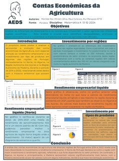
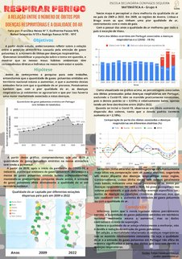
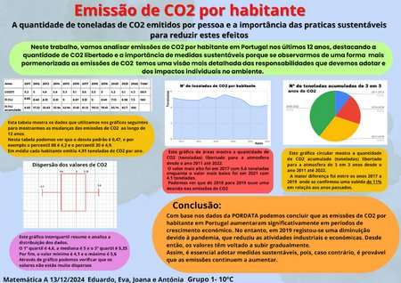
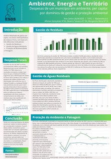
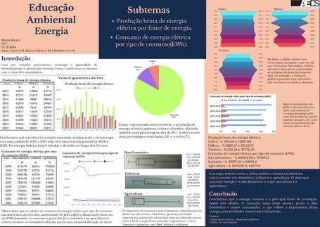

Os alunos das turmas 10.º C e 10.º G demonstraram empenho e dedicação na disciplina de Matemática. Com espírito crítico e criatividade, os alunos envolveram-se ativamente no desenvolvimento de trabalhos que foram além da simples resolução de exercícios, refletindo uma compreensão mais profunda dos conteúdos abordados.

Embora nem todos os trabalhos sejam aqui apresentados, foi realizada uma seleção representativa dos mesmos, com base na qualidade, originalidade e clareza das ideias expostas. Esta seleção, ainda que parcial, permite afirmar com segurança que, de um modo geral, os trabalhos elaborados pelas duas turmas se destacaram positivamente.

As apresentações dos trabalhos à turma revelaram a capacidade dos alunos para aplicar os conhecimentos adquiridos em situações concretas, comunicar raciocínios matemáticos de forma estruturada e colaborar eficazmente em grupo. É de salientar também o cuidado estético e organizacional de vários trabalhos.

Diversificar os meios de avaliação contribui para reforçar o gosto pela Matemática e demonstrar o talento presente na nossa escola.

<strong>Parabéns a todos os alunos envolvidos!</strong>

