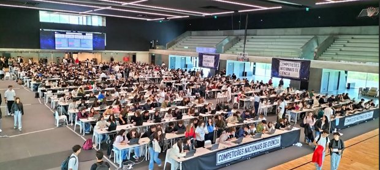
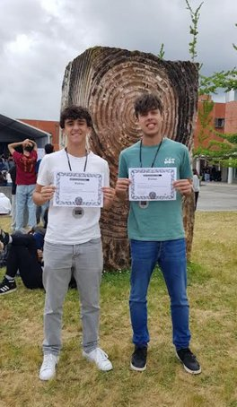
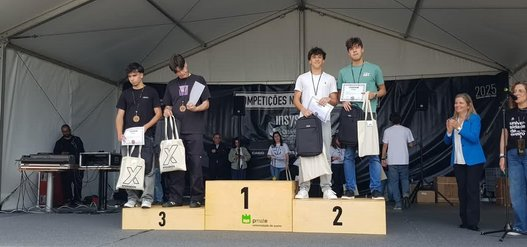
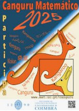
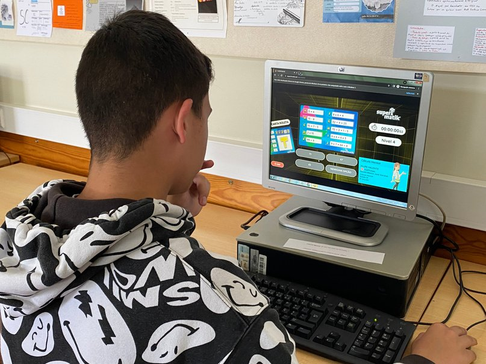
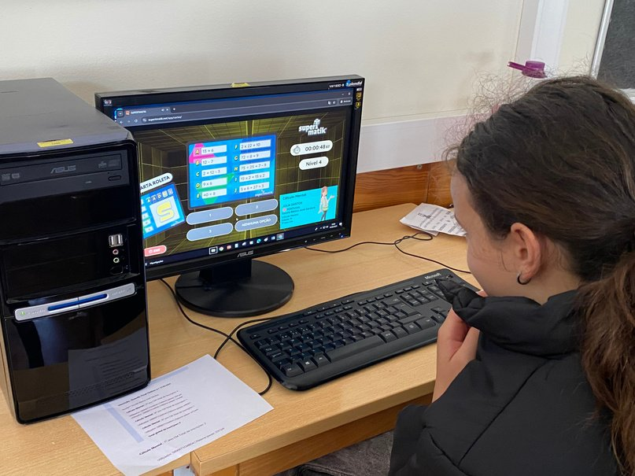
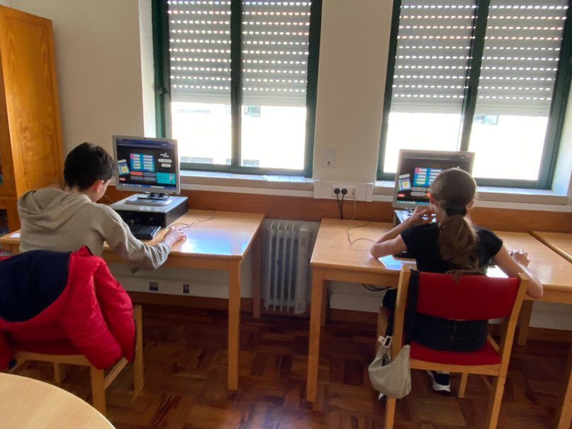
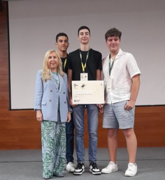
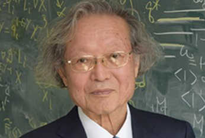

## Competições Nacionais de Ciência

No dia 2 de maio, realizaram-se as Competições Nacionais de Ciência 2025, na Universidade de Aveiro.

A dupla de alunos Lourenço Passadouro e Tiago Henriques, do 12.º A, ganharam o 2.º prémio da competição Xeqmat 12, prova de Matemática. Estes alunos já tinham ganho o 1.º prémio da prova, no ano letivo passado, mas este ano a concorrência foi mais “feroz”.

De realçar o ambiente de entreajuda e satisfação demonstrado pelos nossos alunos. Para alguns, que se encontram no 12.º ano, foi o culminar de 3 anos de participações, com dedicação e entusiasmo. Para os alunos do 10.º ano que aceitaram o desafio, foi o início de uma caminhada que reflete o gosto pela ciência e pela aprendizagem. Parabéns a todos e, em especial, à equipa vencedora do 12.º ano, que ganhou um ano de propinas pagas na Universidade de Aveiro.

## Canguru Matemático

Este ano, o número de participantes quase duplicou relativamente ao ano passado. Concorreram 291 alunos do AEDS, sendo 157 da categoria mini-escolar (do 2.º ao 4.º ano), 82 da categoria escolar (5.º e 6.º anos), 41 da categoria júnior (10.º e 11.º anos) e 11 da categoria estudante (12.º ano). Aguardamos pelos resultados nacionais.

## SuperTmatik

A grande Grande Final Online decorreu entre os dias 1 e 16 de maio. Os finalistas Camila Nascimento (7.º G), Júlia Santos (7.º F), Filipe Valente (8.º B) e André Nogueira (9.º G) aguardam ansiosamente pelos resultados.

<strong>Contamos com a tua participação em futuros eventos!</strong>

## Prémio Pedro Matos 2024

Está a decorrer a candidatura ao concurso **Prémio Pedro Matos 2025**, do qual demos a informação na edição anterior. A entrega de prémios deste concurso decorre em julho, durante o Mat-Oeste, posteriormente à última edição do ano letivo em causa, motivo pelo qual os resultados do concurso de 2024 não foram noticiados em nenhuma edição do +MAT do ano (letivo) passado.

O Instituto Politécnico de Leiria (IPL) reconheceu, pelo 5.º ano consecutivo, o mérito dos alunos do Agrupamento de Escolas Domingos Sequeira, em particular os do ensino secundário. Em 2024, o tema foi “**Matemática em Movimento**”; a comunidade escolar foi desafiada a refletir sobre a Matemática como uma ferramenta dinâmica e poderosa. A iniciativa procurou destacar a capacidade da Matemática em descrever e analisar o movimento e a evolução dos fenómenos de diferentes naturezas, além de sensibilizar o público para a sua presença em todos os aspetos relacionados com o movimento.

No concurso de 2024, 16.ª edição, o projeto “**Matemática: Uma abordagem aos motores**”, desenvolvido pelos alunos **Leonardo Lopes, Rui Silva e Tomás Frazão, da turma 10.º B**, sob a orientação da professora Paula Alexandra Freitas, conquistou o honroso **2.º lugar, a nível nacional**.

Parabéns a todos os participantes, em especial aos alunos premiados.

## Matemático japonês Masaki Kashiwara recebe o Prémio Abel 2025

Oslo, 27/3/2025 — a Academia Norueguesa de Ciências e Letras concedeu o Prémio Abel 2025 ao professor da Universidade de Quioto, no Japão, Masaki Kashiwara, nascido a 30 de janeiro de 1947.

Kashiwara lembra, com carinho, como a sua paixão pela álgebra (ramo da Matemática) surgiu durante a escola, ao resolver um problema chamado Tsurukamezan, que «envolvia calcular o número de gruas e tartarugas a partir do total de cabeças e de pernas. Fiquei encantado com a ideia de generalizar métodos para resolver qualquer problema. Desde então, continuei a explorar novas abordagens e a criar soluções para questões matemáticas complexas», afirmou.

O prémio Abel é um prémio de Matemática atribuído anualmente pelo Rei da Noruega. Foi instituído em 2002, por ocasião do bicentenário do matemático norueguês Niels Henrik Abel (1802–1829), e tem um valor monetário de cerca de 800 000 €.

*Fontes: [abelprize.no](https://www.abelprize.no), [norway.no](https://www.norway.no/pt/brasil/noruega)*
