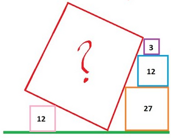

import Desafio from '../../../components/Desafio.astro';

<Desafio numero={1} titulo="Número de bilhetes" resposta="31" unidade="bilhetes" fonte="ONEM 2010 — adaptado">

A escola de Odete vai realizar uma angariação de fundos, vendendo rifas. A turma dela ficou responsável por vender os bilhetes de 2000 até 9999.

Desses bilhetes, o professor Júlio comprou todos nos quais o algarismo 3 aparecia exatamente três vezes.

Depois da compra, o professor deu à Odete todos os bilhetes que comprou cuja numeração tinha algum algarismo 0.

Com quantos bilhetes ficou o professor Júlio?

Contamos primeiro os números de 2000 a 9999 com **exatamente três** algarismos 3.

- **O primeiro algarismo é 3.** Dos três algarismos seguintes, exatamente dois são 3. Escolhemos a posição do algarismo que não é 3 ($3$ maneiras) e o seu valor ($9$ maneiras): $3 \times 9 = 27$ números.
- **O primeiro algarismo não é 3.** Então os três últimos são $333$, e o primeiro pode ser $2, 4, 5, 6, 7, 8$ ou $9$: $7$ números.

O professor comprou $27 + 7 = 34$ bilhetes.

Destes, têm um algarismo 0 apenas $3033$, $3303$ e $3330$ (no segundo caso o primeiro algarismo nunca é 0). Assim, o professor Júlio ficou com

$$
34 - 3 = 31 \text{ bilhetes.}
$$

</Desafio>

<Desafio numero={2} titulo="Calcula a área do quadrado vermelho" fonte="notes.mathforge.org">

Na figura estão, para além do quadrado vermelho, outros 4 quadrados, posicionados como a figura sugere, com áreas 3, 12, 12 e 27.

O quadrado de área 3 está colocado sobre o quadrado de área 12, centrado neste.

Qual é a área do quadrado vermelho?

</Desafio>

<Desafio
  numero={3}
  titulo="2 = 1. Onde está o erro?"
  resposta="Ao dividir ambos os membros por (a − b)"
  opcoes={[
    'Ao multiplicar ambos os membros por a',
    'Ao aplicar a diferença de quadrados',
    'Ao dividir ambos os membros por (a − b)',
    'Ao substituir a por b',
  ]}
>

Sejam $a$ e $b$ dois números reais, sendo ambos diferentes de zero. Suponhamos que $a = b$.

Então, se $a = b$, multiplicando os dois lados da igualdade por $a$ temos: $a^2 = ab$.

Subtraindo $b^2$ dos dois lados da igualdade temos: $a^2 - b^2 = ab - b^2$.

Aplicando a diferença de quadrados, temos: $a^2 - b^2 = (a - b)(a + b)$.

Colocando $b$ em evidência do lado direito temos: $(a - b)(a + b) = b(a - b)$.

Dividindo ambos os membros por $(a - b)$ temos: $a + b = b$.

Como no início dissemos que $a = b$, então no lugar de $a$ podemos colocar $b$. Ficamos com $b + b = b$, ou seja, $2b = b$.

Finalmente, dividindo ambos os membros por $b$ chegamos à conclusão: $2 = 1$.

Obviamente que esta demonstração possui um erro, pois todos nós sabemos que 2 não é igual a 1 (ou alguém tem alguma dúvida?)!

Como $a = b$, temos $a - b = 0$. No passo em que se “dividem ambos os membros por $(a - b)$” está-se, na verdade, a **dividir por zero**, o que não é permitido.

A igualdade $(a - b)(a + b) = b(a - b)$ é verdadeira, mas apenas porque ambos os membros valem $0$. Daí não se pode concluir que $a + b = b$: por exemplo, $0 \times 5 = 0 \times 3$ e, no entanto, $5 \neq 3$.

</Desafio>
