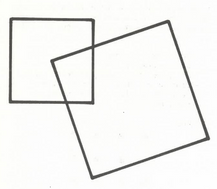
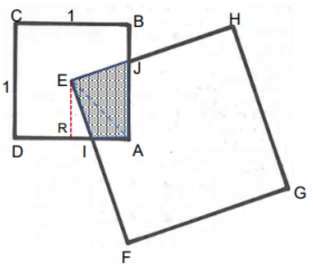
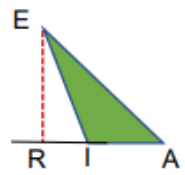
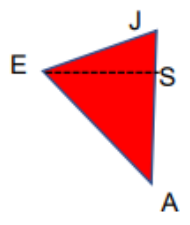

import Desafio from '../../../components/Desafio.astro';

<Desafio numero={1} titulo="Quantas girafas e quantas avestruzes?" fonte="Ah, descobri!, Martin Gardner">

Antes de saírem do parque, Bob e Helen atravessaram o Jardim Zoológico. Numa jaula viram uma mistura de girafas e de avestruzes.

Depois de terem saído, Bob falou com Helen:

— Contaste as girafas e as avestruzes? 
— Não, quantas eram? 
— Descobre tu. Ao todo, tinham 30 olhos e 44 pés.

$x$ girafas e $y$ avestruzes têm $2x + 2y$ olhos e $4x + 2y$ pés. Assim,

$$
\begin{cases} 2x + 2y = 30 \\ 4x + 2y = 44 \end{cases}
$$

o que nos dá $x = 7$ e $y = 8$. A resposta é **7 girafas e 8 avestruzes**.

</Desafio>

## Desafios lógicos — Na Selva (R. Smullyan)

- O Leão (L) mente às segundas, terças e quartas, dizendo sempre a verdade nos outros dias.
- O Unicórnio (U) mente às quintas, sextas e sábados, dizendo sempre a verdade nos outros dias.

<Desafio numero="2a" titulo="O Leão sozinho">

Numa ocasião, a Alice encontrou o Leão sozinho. Ele fez as seguintes afirmações:

- “Ontem foi dia de eu mentir.”
- “Vou mentir daqui a 3 dias.”

Em que dia da semana estamos?

|       | Dom | Seg | Ter | Qua | Qui | Sex | Sáb |
| ----- | :-: | :-: | :-: | :-: | :-: | :-: | :-: |
| Leão  | V   | M   | M   | M   | V   | V   | V   |

A frase “ontem foi dia de eu mentir” podia ter sido proferida pelo Leão à segunda ou à quinta-feira.

A frase “vou mentir daqui a 3 dias” só não poderia ter sido proferida pelo Leão à quinta-feira.

Logo, é **segunda-feira**.

</Desafio>

<Desafio numero="2b" titulo="O Leão e o Unicórnio">

Numa ocasião, a Alice encontrou o Leão e o Unicórnio, que lhe disseram:

- U: “Ontem foi dia de eu mentir.”
- L: “Amanhã vou dizer a verdade.”

Em que dia da semana estamos?

|           | Dom | Seg | Ter | Qua | Qui | Sex | Sáb |
| --------- | :-: | :-: | :-: | :-: | :-: | :-: | :-: |
| Unicórnio | V   | V   | V   | V   | M   | M   | M   |

A frase “ontem foi dia de eu mentir” podia ter sido proferida pelo Unicórnio ao domingo ou à quinta-feira.

A frase “amanhã vou dizer a verdade” podia ter sido proferida pelo Leão todos os dias exceto quarta e domingo.

Logo, é **quinta-feira**.

</Desafio>

<Desafio numero={3} titulo="No quadrado" fonte="100 jogos geométricos, Pierre Berloquin">

O quadrado pequeno tem 1 m de lado e o grande 1,5 m. Este tem um dos vértices no centro do quadrado pequeno.

O lado do quadrado grande corta o lado do pequeno ao terço do seu comprimento.

Qual é a superfície da parte comum dos dois quadrados?

**Resolução 1.** Sejam:

- $[ABCD]$ o quadrado pequeno: $\overline{CD} = \overline{DA} = 1$ m;
- $[EFGH]$ o quadrado grande: $\overline{EF} = \overline{EH} = 1{,}5$ m.

Como “o lado do quadrado grande corta o lado do pequeno ao terço do seu comprimento”, tem-se

$$
\overline{IA} = \tfrac{1}{3} \quad\text{e}\quad \overline{JB} = \tfrac{1}{3}, \quad\text{logo}\quad \overline{JA} = \tfrac{2}{3}.
$$

Seja $R$ a projeção ortogonal de $E$ sobre $[DA]$. A parte comum dos dois quadrados é o quadrilátero $[EIAJ]$, cuja área pode ser obtida pela soma das áreas dos triângulos $[EIA]$ e $[AJE]$.

$$
\text{área}\,[EIA] = \overline{IA} \times \overline{ER} \times \tfrac{1}{2} = \tfrac{1}{3} \times \tfrac{1}{2} \times \tfrac{1}{2} = \tfrac{1}{12}
$$

Sendo $S$ a projeção ortogonal de $E$ sobre $[AB]$, vem

$$
\text{área}\,[AJE] = \overline{AJ} \times \overline{ES} \times \tfrac{1}{2} = \tfrac{2}{3} \times \tfrac{1}{2} \times \tfrac{1}{2} = \tfrac{1}{6}
$$

Então, a área pedida é

$$
\frac{1}{12} + \frac{1}{6} = \frac{1}{4}\ \text{m}^2.
$$

**Resolução 2.** A área do quadrado $[ABCD]$ é igual a $1\ \text{m}^2$.

Por uma rotação do quadrado $[EFGH]$ em torno de $E$, que aplica $I$ em $R$ ($J$ será aplicado em $S$, projeção ortogonal de $E$ sobre $[AB]$), a região comum é o quadrado $[ERAS]$, cuja área corresponde a $\frac{1}{4}$ da área de $[ABCD]$, ou seja, igual a $\frac{1}{4}\ \text{m}^2$.

</Desafio>
